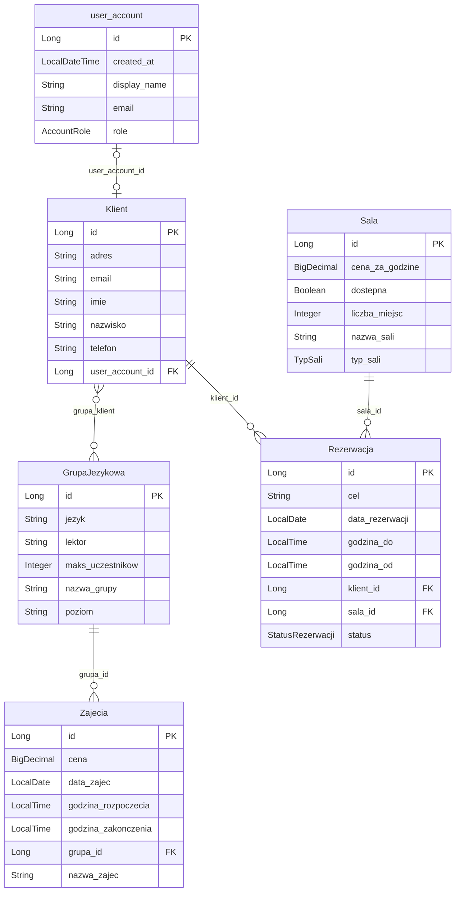

# Schemat bazy danych

Plik generują reguły projektu (panel Maven → Lifecycle → verify). Nie edytujcie go ręcznie.

Tabele: 7 (w tym tabele łączące @ManyToMany: grupa_klient) · kolumny: 39 · relacje: 3 × @ManyToOne, 1 × @OneToMany, 1 × @OneToOne, 1 × @ManyToMany

| Tabela | Encja | Kolumny | Klucze obce |
|---|---|---|---|
| GrupaJezykowa | GrupaJezykowa | 6 | — |
| Klient | Klient | 7 | user_account_id |
| Rezerwacja | Rezerwacja | 8 | klient_id, sala_id |
| Sala | Sala | 6 | — |
| Zajecia | Zajecia | 7 | grupa_id |
| user_account | UserAccount | 5 | — |

